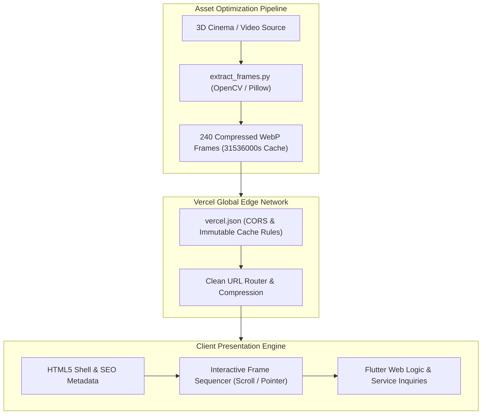

# NovusTech Web Platform: High-Performance Digital Landing Showcase

<div align="center">

[](https://novustech.in/)
[](https://flutter.dev)
[](https://vercel.com)
[](LICENSE)

**Official enterprise showcase and interactive 3D product visualizer for NovusTech engineering solutions.**

</div>

---

## Architectural Architecture

NovusTech Web delivers 60 FPS interactive hardware and software visualizations on modern browsers. High-resolution 3D renders are decomposed into 240 optimized WebP sequence frames via automated Python scripts and dynamically blended on HTML5 canvas elements beneath Flutter Web layout structures.



---

## Technical Highlights

- **Scroll-Linked Frame Scrubbing**: Renders continuous 240-frame sequence animations synchronized with viewport scroll depth and gesture velocity.
- **Aggressive Edge Asset Caching**: `vercel.json` directs CDN edge nodes to serve all visual frames with `max-age=31536000, immutable` and CORS headers.
- **Search Engine Optimization**: Implements full Open Graph protocol tags, JSON-LD metadata, dynamic sitemap (`sitemap.xml`), and robots directive (`robots.txt`).
- **Responsive Layout Architecture**: Fully adaptive layouts scaling across ultra-wide desktop monitors, laptops, tablets, and mobile devices.

---

## Repository Structure

```
novus-web/
├── assets/                  # High-density graphics, fonts, and brand identity
├── extract_frames.py        # Automated video-to-WebP sequence generator
├── index.html               # Production HTML shell with preloading links
├── public/                  # Publicly accessible static resources
├── vercel.json              # Edge CDN routing and immutable cache rules
└── web/                     # Web deployment assets and frame bundles
    └── assets/
        └── frames/          # 240 WebP canvas render frames (frame_001.webp - frame_240.webp)
```

---

## Local Development & Asset Generation

### 1. Frame Extraction Pipeline

```bash
# Prepare python environment with imaging dependencies
pip install opencv-python pillow

# Decompose video assets into sequence frames
python extract_frames.py
```

### 2. Local Preview

```bash
# Serve current static root using Python HTTP server
python3 -m http.server 3000

# Open in browser
open http://localhost:3000
```

### 3. Production Deployment

The platform is integrated with continuous deployment through Vercel:

```bash
# Deploy preview build to Vercel
vercel

# Deploy production release
vercel --prod
```

---

## License

This project is licensed under the MIT License. See the [LICENSE](LICENSE) file for complete details.
